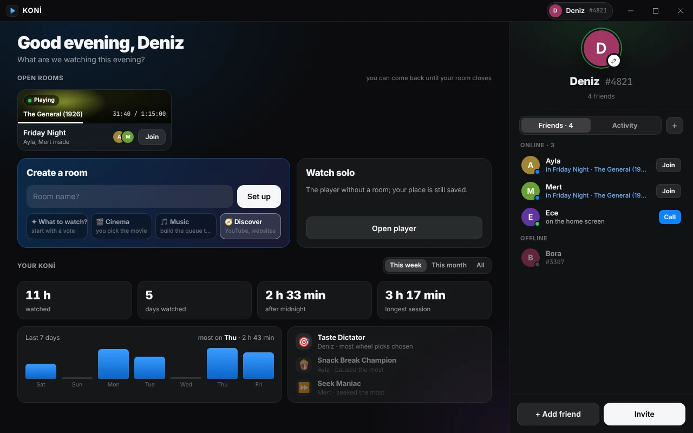
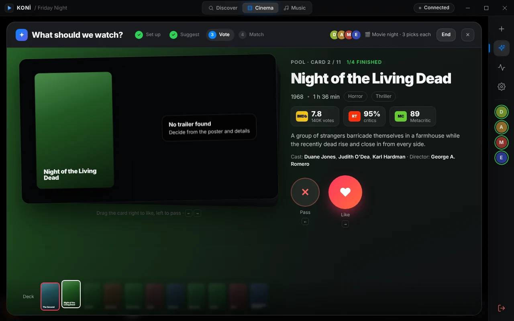
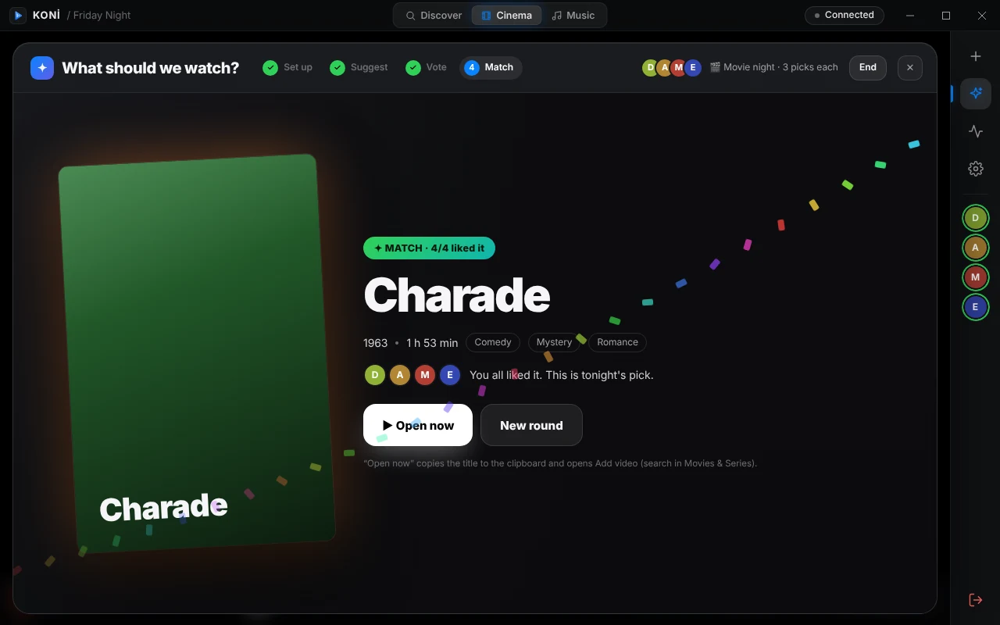
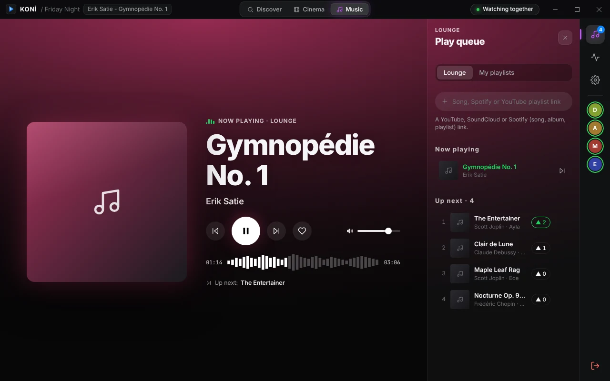
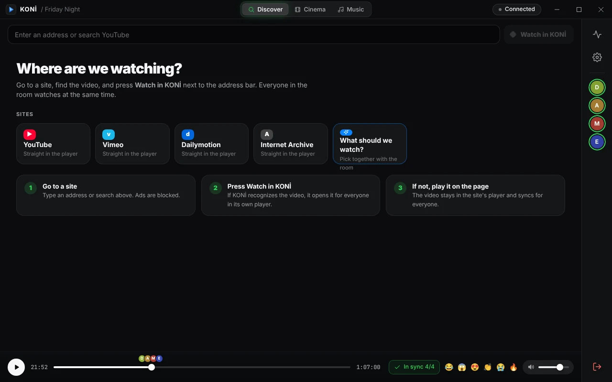

<div align="center">

# ▶ KONİ

**Watch, listen and pick together. A desktop app for groups of friends.**

Make a room, call your friends in, and everyone sees the same frame at the same moment.

[**⬇ Download for Windows and macOS**](https://github.com/Savas07/koni-releases/releases/latest) ·
[Run your own server](docs/SELF-HOSTING.md) ·
[Release notes](docs/releases/) ·
[Türkçe](#türkçe)


-000000?logo=apple&logoColor=white)




</div>

---

## What can it do? (30-second tour)

| | | |
|:--|:--|:--|
| 🎬 **Cinema**<br>Play a file or link together. Pause, seek and resume land on everyone's screen. | 🎵 **Music**<br>A shared queue for the room. Vote songs up, keep playlists, see lyrics. | 🧭 **Discover**<br>Search YouTube or open a site. Press *Watch in KONİ* and the room follows. |
| ✦ **What should we watch?**<br>Everyone suggests, everyone swipes. The first title you all like wins. | 👥 **Friends**<br>Invite-only accounts, `Name#1234` tags, see who is online and in which room. | 📊 **Stats & badges**<br>Hours watched, late nights, and a *Snack Break Champion* every week. |

Each room has one of three modes (Discover, Cinema, Music). The host can switch it at any time, for everyone.

---

## A tour of the app

<details open>
<summary><b>✦ What should we watch? Swipe until you all agree</b></summary>
<br>

No more 40 minutes of scrolling. The host starts a round and the screen opens for everyone with a countdown.

1. **Set up**: movie or series, picks per person, and a mood or your own filter (genre, era, length, rating, language, hide what you've seen).
2. **Suggest**: everyone adds 1–3 titles. Suggestions go into an anonymous pool.
3. **Vote**: swipe right to like, left to pass. Each card shows the year, length, IMDb / Rotten Tomatoes / Metacritic scores, cast, and a muted trailer when there is one.
4. **Match**: the first title everyone liked wins, with confetti. No match? The most-liked picks go onto a wheel and fate decides.





</details>

<details>
<summary><b>🎵 Music: a shared Lounge queue</b></summary>
<br>

- Paste a YouTube, SoundCloud or Spotify link (a song, album or playlist). Everyone hears the same second.
- Vote songs up the queue. Skip and seek are shared.
- Synced lyrics, a waveform seek bar and a visualizer.
- Save your own playlists on your computer and feed them into the room.
- Music mode only plays audio, so it stays light even on slow connections.



</details>

<details>
<summary><b>🧭 Discover: watch from the web together</b></summary>
<br>

- Type an address or search YouTube from the bar.
- If KONİ recognises the video, it opens in KONİ's own player for everyone.
- If not, the video stays in the site's player and KONİ keeps it in sync for the whole room.
- The built-in browser blocks ads and runs in its own separate profile.



</details>

<details>
<summary><b>🎬 Cinema: your files and links, in sync</b></summary>
<br>

- Open a video file from your computer or a link. Everyone in the room opens their own copy and KONİ keeps them together.
- Hardware-accelerated playback with [mpv](https://mpv.io/), in a cockpit layout: video on the left, room on the right.
- Find subtitles by searching, then share them with the room in one click. Fix timing with `g` / `h`.
- Audio track, subtitle and quality are personal: switching yours doesn't change anyone else's.
- Quick reactions (😂 😱 😍 👏 😭 🔥) float over the video for everyone.
- Your place is saved, so you can pick up a movie where you left it.

</details>

<details>
<summary><b>👥 Friends, rooms and profiles</b></summary>
<br>

- **Invite-only.** Members create invite links. The link carries your server's address, so a friend only has to click it. Whoever joins with it becomes your friend.
- **Add friends** by `Name#1234`. Only friends can be called into a room.
- **Open rooms** stay on the home screen, so you can drop back in until the room closes.
- **Lists**: *Watchlist* and *Watched*. Watch 80% of a movie together and it's added to *Watched* with who you watched it with.
- **Privacy**: stats and lists are visible only to mutual friends.
- **Hosts and co-hosts** decide who controls playback. Admins get a panel for rooms, members and bans.

</details>

<details>
<summary><b>📊 Stats and badges</b></summary>
<br>

Your week at a glance: hours watched, days watched, time after midnight, longest session. Badges rotate among friends:

| Badge | Goes to |
|:--|:--|
| 🍿 Snack Break Champion | whoever paused the most |
| ⏩ Seek Maniac | whoever seeked the most |
| 🦉 Night Owl | most watching between 00:00 and 04:00 |
| 📡 Dial-up Sound | kept the room waiting the most |
| 🎯 Taste Dictator | most wheel picks chosen |
| 🗑️ Rejected Genius | most wheel picks eliminated |
| ❤️ Easy to Please | highest like rate when swiping |
| 🎧 DJ Booth | added the most songs to the queue |
| 🏃 Marathoner | 4+ hours in a single session |

</details>

---

## How the sync works

KONİ never streams video through its server. Every member plays the media on their own machine, and a small server only shares the room's clock and state.

```text
 Your PC ──┐                          ┌── Friend's PC
  (mpv)    │   play / pause / seek    │    (mpv)
           ├──── room clock, chat ────┤
 Friend ───┘   small sync server      └── Friend
```

<details>
<summary><b>The rules it follows</b></summary>
<br>

- **Nobody gets rewound.** Small drift (50 ms – 3 s) is fixed by playing 0.96×–1.04× speed with pitch correction, so you don't hear it.
- **A short stall pauses the room** for a moment instead of throwing everyone back.
- **Someone keeps buffering?** After 3 stalls in 4 minutes the host can continue without them. They catch up with *Sync with room*.
- **Hosts can lock controls** so only they and co-hosts can play, pause or seek.
- **Connection drops** reconnect on their own and put you back in your seat.

More detail: [docs/design/sync.md](docs/design/sync.md) and [docs/PROTOCOL.md](docs/PROTOCOL.md).

</details>

---

## Get started

1. **Download** the latest version from the [releases page](https://github.com/Savas07/koni-releases/releases/latest). On Windows run the installer (`…_x64-setup.exe`): it installs for your user only, no admin rights needed. On a Mac (M1 or newer) open the `.dmg` and drag KONİ into Applications. KONİ updates itself after that.
2. **Join a server.** KONİ has no built-in server: each group of friends runs its own. Click a friend's invite link and the sign-up screen fills in by itself. Starting a new group? [Host your own server](docs/SELF-HOSTING.md), enter its address on the first screen, and make the first invite yourself.
3. **Create a room**, pick a mode, and call your friends in.

> [!NOTE]
> KONİ is not code-signed, so your computer asks once on the first launch.
> - **Windows**: SmartScreen says it protected your PC. Choose *More info → Run anyway*.
> - **macOS**: macOS says it can't verify the app. On macOS 14 or older, right-click KONİ in Applications → *Open* → *Open*. On macOS 15 or newer, try to open it once, then go to *System Settings → Privacy & Security*, scroll down and click *Open Anyway* next to KONİ.
>   If it still won't open, run `xattr -dr com.apple.quarantine /Applications/KONI.app` in Terminal.

> [!IMPORTANT]
> KONİ is a player, not a content source. It hosts and ships no media and no streaming sources. Title info such as names, posters, ratings and episode lists comes from public metadata services. Use KONİ with your own files and with content you have the right to watch.

<details>
<summary><b>🖥️ Host your own server</b></summary>
<br>

The server is a single Go binary with SQLite. A 1 vCPU / 1 GB VPS is plenty for a group of friends. Your accounts, invites, friends and stats then live only on your server.

```sh
git clone https://github.com/serkanqltun-hub/koni /opt/koni/src
cd /opt/koni/src
DOMAIN=koni.example.com NGINX=1 ./deploy/install.sh
```

On first launch KONİ asks for a server address. Enter yours there; invite links you create then carry it to your friends. The full guide: [docs/SELF-HOSTING.md](docs/SELF-HOSTING.md).

</details>

<details>
<summary><b>🛠️ Build from source</b></summary>
<br>

| Part | Stack | Folder |
|:--|:--|:--|
| Desktop app | Tauri 2, Rust, Svelte 5, libmpv, yt-dlp | [`client/`](client/) |
| Sync server | Go, WebSocket, SQLite | [`server/`](server/) |
| Deploy | systemd, nginx, Let's Encrypt | [`deploy/`](deploy/) |

Run the app on Windows (Node 22, Rust stable, WebView2):

```sh
cd client
npm ci
npx tauri dev   # put libmpv-2.dll next to the exe in target/debug first
```

On a Mac (Apple Silicon), `client/scripts/build-macos.sh <libmpv-lgpl-macos-arm64.zip>` builds `KONI.app` and the `.dmg`.

Run the server and its tests:

```sh
cd server
go test ./...
go run ./cmd/koni-server -db koni.db   # listens on :8080
```

Details: [client/README.md](client/README.md), [docs/LIBMPV.md](docs/LIBMPV.md), [docs/UPDATES.md](docs/UPDATES.md), the plan in [docs/PLAN.md](docs/PLAN.md) and decisions in [docs/adr/](docs/adr/).

</details>

<details>
<summary><b>🗺️ Platforms and roadmap</b></summary>
<br>

- ✅ Windows 10 / 11
- 🆕 macOS 11 or newer on Apple Silicon (M1 or newer). New and tested less than Windows. *Cast to TV* is Windows-only; on a Mac use AirPlay screen mirroring from Control Center. The Discover browser has no extra ad-blocking extension on macOS.
- 💤 Linux (maybe later)

What changed in each version: [docs/releases/](docs/releases/).

</details>

---

## Türkçe

**KONİ, arkadaş grupları için ortak izleme ve dinleme uygulaması.** Oda kur, arkadaşlarını çağır; herkes aynı anı aynı saniyede görür.

- **Sinema:** kendi dosyan ya da linkin, herkeste senkron. Altyazı bul, odayla paylaş.
- **Müzik:** odanın ortak çalma sırası, oylama, şarkı sözleri, çalma listeleri.
- **Keşfet:** YouTube'da ara ya da bir siteye git, *KONİ'de izle* de, oda seninle gelsin.
- **Ne izlesek?:** herkes önerir, herkes kaydırır; hepinizin beğendiği ilk film kazanır, eşleşme yoksa çark karar verir.
- **Arkadaşlar, listeler, istatistik ve rozetler:** yalnızca karşılıklı arkadaşlar görür.

KONİ hazır bir sunucuyla gelmez: her arkadaş grubu kendi sunucusunu kurar. Arkadaşının davet linkine tıklarsan sunucu adresi kendiliğinden gelir; yeni bir grup kuruyorsan ilk ekranda kendi sunucunun adresini yazarsın.

Windows 10/11 ve macOS 11+ (Apple Silicon, M1 ve sonrası) için. Uygulama imzasız olduğundan ilk açılışta bir kez onay ister: Windows'ta *Ek bilgi → Yine de çalıştır*; Mac'te macOS 14 ve öncesinde uygulamaya sağ tık → *Aç*, macOS 15 ve sonrasında bir kez açmayı dene, sonra *Sistem Ayarları → Gizlilik ve Güvenlik* → *Yine de Aç*.

Uygulama varsayılan olarak İngilizce açılır; **Ayarlar**'dan ya da giriş ekranından Türkçe seçilebilir. İndirmek için [sürümler sayfası](https://github.com/Savas07/koni-releases/releases/latest), kendi sunucunu kurmak için [docs/SELF-HOSTING.md](docs/SELF-HOSTING.md).

---

<div align="center">

[MIT License](LICENSE) · Playback by [libmpv](https://mpv.io/) (LGPL, loaded as a replaceable library) · [Third-party notices](THIRD-PARTY-NOTICES.md)

<sub>Screenshots use sample data and public-domain titles.</sub>

</div>
