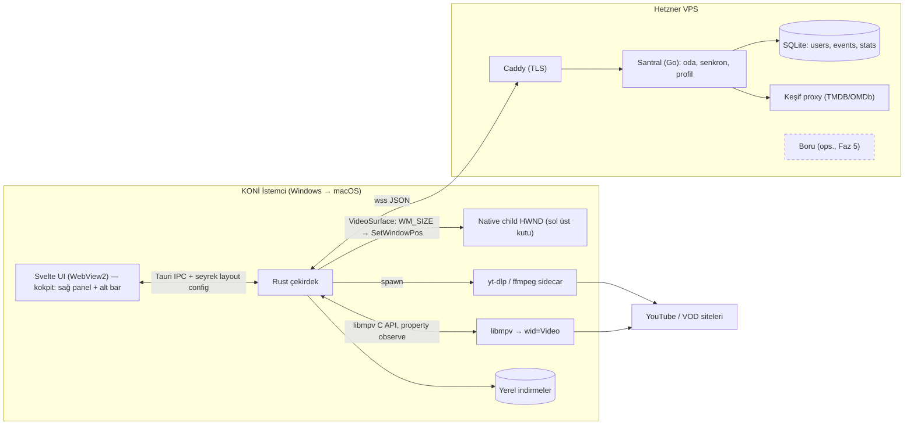

# KONİ — Teknik ve Proje Planı

> **KONİ**: Arkadaş grupları için oda tabanlı, düşük gecikmeli, donanım hızlandırmalı masaüstü ortak medya istasyonu (watch-together).
> Doküman sürümü: **v0.4** (taslak) · Tarih: 2026-10-29
> İşaretleme: **[doğrulanmalı]** etiketi, PoC veya güncel dokümantasyonla teyit edilmesi gereken teknik iddiaları gösterir. **[onay gerekli]** etiketi kullanıcı kararı bekleyen noktaları gösterir.

### v0.4 değişiklikleri (doküman bölündü)
- Plan tek dosyadan bölündü: bu dosya özet, mimari, teknoloji yığını, yol haritası ve durumu tutar; ayrıntılar `design/` altında, kararlar `adr/` altında. Bölüm numaraları korundu (`§4.4` → [design/sync.md](design/sync.md)).
- §4.6 mesaj şeması kaldırıldı; kesin sözleşme [PROTOCOL.md](PROTOCOL.md). Eski taslaktaki `room_hold`/`countdown` mesajları yerine `state.mode` kullanılır.

### v0.3.1 değişiklikleri (son açık noktalar kilitlendi)
- **Ciddi desync eşiği 3.0 s olarak sabitlendi.** 50 ms – 3.0 s arası sapma yalnızca hızla düzeltilir. Sınır 2.5 s olsaydı ev internetindeki küçük dalgalanmalar hız kontrolcüsüne çok az pay bırakır ve odayı gereksiz yere `HOLD`'a sokardı.
- **Histerezis rezervi 12 s, kronik kural "4 dk'da 3 stall"** olarak sabitlendi. 10 s yüksek bitrate videoda çabuk tükenebilir, 15 s de beklemeyi uzatır.
- **Lisans kararı**: libmpv dinamik kütüphane olarak yükleniyor ve LGPL sınırlarında kalınıyor. Bunun koşulları [design/risks.md §11.3](design/risks.md)'te (LGPL build, atıf ve kaynak, DLL'in değiştirilebilmesi).

### v0.3 değişiklikleri
- **Anti-rubberbanding**: Drift'i düzeltmek için **asla geri seek yapılmaz**. 50 ms – 3.0 s arası sapma yalnızca dinamik hızla (0.96x–1.04x, `audio-pitch-correction=yes`) kapatılır. Hard seek yalnızca bilinçli timeline scrub'da ve > 3.0 s ciddi desync'te yapılır. Ciddi geride kalan biri için 30 s'ye kadar "freeze over rewind", 30 s üstünde ileri seek uygulanır, ciddi önde kalan biri için yerel hold. Yeni senkron state makinesi ve mesaj örnekleri eklendi ([design/sync.md §4.4–4.6](design/sync.md)).
- **Histerezis buffer kapısı**: Stall eden istemci 12 s güvenlik rezervi tamponlamadan geri sayım başlamaz. Ekranda "Furkan bekleniyor... [Buffer: %65]" rozeti çıkar. Kronik kopmada (4 dk'da 3 stall) host'a [Furkan olmadan devam et] seçeneği, geride kalana "Odayla Senkronla" sunulur ([design/sync.md §4.7](design/sync.md)).
- **Pencere yönetimi**: Video kutusu koordinatları JS `ResizeObserver` roundtrip'i yerine doğrudan Rust'ta `WM_SIZE`/`WM_DPICHANGED`/`WM_WINDOWPOSCHANGED` olaylarından hesaplanır. Svelte yalnızca seyrek "layout config" gönderir ([design/client.md §3.2](design/client.md)).
- **`VideoSurface` trait'i**: Platform soyutlaması eklendi. Windows child HWND ve macOS NSView/render context aynı Svelte ve WS sözleşmeleriyle çalışır ([design/client.md §3.3](design/client.md)).
- **Kapsam daraltma**: Canlı yayın senkronu kalıcı olarak kapsam dışı. Senkron yalnızca VOD, doğrudan dosya ve seek edilebilir timeline'lar için. Kimlik sıfır PII (davet + argon2id). Discord/OAuth v1 dışı. Oyunlaştırılmış metrikler varsayılan olarak tüm oda üyelerine açık.
- Kabul kriterleri (geri seek = 0, histerezis testi, resize'da takılma yok) ve riskler (hız düzeltme süresi, müzikte pitch artefaktı) güncellendi.

v0.2 değişiklikleri (özet)

Kokpit modeli (overlay iptal), Windows-önce platform sırası, hafif profil + SQLite istatistik/rozetler, çekirdek akışa göre yeniden sıralanmış yol haritası, RD/addon en sona ve opsiyonel.

---

## Doküman haritası

| Dosya | İçerik |
|---|---|
| [design/client.md](design/client.md) | §3 İstemci: kokpit modeli, child HWND, `VideoSurface`, libmpv, yt-dlp |
| [UI-PLAN.md](UI-PLAN.md) | Arayüz/UX planı: ekranlar, akışlar, tasarım sistemi, ikon (taslak, onay bekliyor) |
| [design/sync.md](design/sync.md) | §4 Senkron: saat, oda modeli, drift düzeltme, state makinesi, stall, roller |
| [PROTOCOL.md](PROTOCOL.md) | WebSocket mesaj sözleşmesi (kesin kaynak) |
| [design/accounts.md](design/accounts.md) | §5 Kimlik, SQLite şeması, istatistik ve rozetler |
| [design/media.md](design/media.md) | §6 İndirme bariyeri, altyazı, müzik Lounge |
| [design/discovery.md](design/discovery.md) | §7 Keşif motoru, mood eşlemesi, swipe/çark |
| [design/debrid.md](design/debrid.md) | §8 Opsiyonel Real-Debrid / addon modu |
| [design/risks.md](design/risks.md) | §11 Teknik ve yasal riskler, açık sorular, lisans kararı |
| [LIBMPV.md](LIBMPV.md) | LGPL libmpv derlemesi |
| [../deploy/README.md](../deploy/README.md) | Santral VPS kurulumu |

### Kararlar (ADR)
| # | Karar |
|---|---|
| [0001](adr/0001-kokpit-modeli.md) | Kokpit modeli: video ve web UI yan yana |
| [0002](adr/0002-windows-once.md) | Platform sırası: önce Windows |
| [0003](adr/0003-videosurface.md) | `VideoSurface` platform soyutlaması |
| [0004](adr/0004-geri-seek-yok.md) | Anti-rubberbanding: düzeltme amaçlı geri seek yok |
| [0005](adr/0005-sifir-pii.md) | Kimlik: sıfır PII |
| [0006](adr/0006-libmpv-lgpl.md) | libmpv: dinamik yükleme, LGPL derleme |
| [0007](adr/0007-rd-kendi-anahtari.md) | Real-Debrid: varsayılan "herkes kendi anahtarı" |
| [0008](adr/0008-santral-vps.md) | Santral yayını: ana sunucu |

---

## 1. Özet, Hedefler ve Kapsam Dışı

### 1.1 Özet
KONİ, küçük bir arkadaş grubunun (2–8 kişi) aynı odaya girip web videolarını, müziği ve yerel/indirilmiş dosyaları senkron izlemesini/dinlemesini sağlayan bir masaüstü uygulamasıdır. Oynatma her istemcide **yerel olarak libmpv** ile (GPU decode) yapılır. Sunucu (Santral) **durum senkronu**, profiller ve istatistikler için vardır. Görüntü sunucudan yayınlanmaz: herkes aynı kaynağı kendi tarafında oynatır ve konumlar hizalanır.

### 1.2 Hedefler
| # | Hedef | Ölçülebilir kriter |
|---|---|---|
| H1 | Düşük gecikmeli senkron | Kararlı durumda istemciler arası sapma medyan < 50 ms, p95 < 100 ms (24 fps'te ~1–2 kare) |
| H2 | Hızlı tepki | Play/pause/seek'in diğer istemcilere yansıması < RTT + 150 ms |
| H3 | Donanım hızlandırma | 4K HEVC/AV1 içerikte (destekleyen GPU'da) hwdec aktif, CPU < %25 |
| H4 | Kokpit deneyimi | Sabit grid, video/UI çakışması yok, tek tuşla tam ekran ↔ kokpit |
| H5 | Reklamsız link oynatma | Link yapıştırmadan oynatmaya ≤ 5 sn (tipik YouTube) |
| H6 | Eğlence katmanı | Profil, istatistik kartları, rozetler; keşifte < 3 dk'da karar |
| H7 | Rubberbanding yok | Düzeltme amaçlı geri seek sayısı = 0; diyalog/kare tekrarı yok |

### 1.3 Kapsam Dışı (v1)
- Mobil ve tarayıcı istemcisi; Linux (ileride, opsiyonel).
- **Canlı yayın senkronu (Twitch/Kick vb.) — kalıcı olarak kapsam dışı.** Senkron yalnızca VOD, doğrudan dosya ve seek edilebilir container timeline'larında çalışır.
- Üçüncü taraf girişler (Discord OAuth vb.).
- Video üstüne saydam UI overlay (v0.2'de bilinçli olarak iptal edildi).
- Ekran paylaşımı/WebRTC video yayını, sesli sohbet (Discord kullanılıyor varsayımı).
- Kamuya açık oda keşfi, büyük ölçek.
- DRM'li servisler (Netflix vb.). libmpv ile oynatılamaz.
- Çekirdekte torrent istemcisi ve genel amaçlı proxy altyapısı. RD/addon yalnızca son, opsiyonel fazda.

---

## 2. Mimari Genel Bakış

### 2.1 Bileşenler
1. **KONİ İstemci (Tauri v2)**: Rust çekirdek + Svelte UI (WebView2) + native child pencerede libmpv + yt-dlp/ffmpeg sidecar + yerel indirme önbelleği.
2. **KONİ Santral (Go, VPS)**: WebSocket oda/senkron sunucusu, profil/oturum yönetimi, SQLite (profiller, event log, istatistik), keşif proxy'si (API anahtarlarını istemciden saklar), swipe/çark state'i.
3. **Caddy**: TLS sonlandırma (`wss://`, `https://`).
4. **Opsiyonel (Faz 5) Boru**: Real-Debrid/addon range proxy'si. Varsayılan kurulumda kapalı.
5. **Harici servisler**: yt-dlp'nin eriştiği siteler, OpenSubtitles, TMDB, OMDb, Trakt (ops.), LRCLIB.

### 2.2 Diyagram

### 2.3 Temel Veri Akışları
- **Senkron**: Kullanıcı aksiyonu → Rust → `wss` → Santral (yetki + state + event log) → diğer istemciler → libmpv'ye `pause`/`seek`/`speed`.
- **Link stream**: Odaya yalnızca URL metni gider. **Her istemci kendi yt-dlp'si ile çözer**, çünkü YouTube vb. imzalı URL'ler genellikle IP/oturuma bağlıdır. Sonra mpv doğrudan oynatır. Bu yolda reklam da yoktur, çünkü yt-dlp ham medya akışını çıkarır.
- **İndir-Senkron**: Host "Herkes İndirsin" der → herkes yerel indirir ve ilerlemeyi raporlar → Santral bariyeri tutar → herkes hazır olunca planlı başlangıç.
- **İstatistik**: Santral her anlamlı olayı (`pause`, `seek`, `join`, `vote`...) `events` tablosuna yazar. Hub kartları agregasyon sorgularından/özet tablolardan beslenir.

---

## 9. Teknoloji Yığını

| Bileşen | Seçim | Alternatif | Gerekçe |
|---|---|---|---|
| Masaüstü kabuk | Tauri v2 | Electron, Qt | Küçük paket, Rust çekirdek, native HWND erişimi |
| UI | Svelte 5 + Vite + TS | React | Hafif, reaktif, az boilerplate |
| Video yerleşimi | Kokpit grid + `VideoSurface` trait'i (Win: child HWND `wid`, konum Rust'ta `WM_SIZE`'dan) | Overlay (iptal), JS ResizeObserver roundtrip'i | Çakışma yok, modal resize döngüsünde takılma yok, platform değişiminde UI/WS sözleşmesi sabit |
| Oynatıcı | libmpv (Win: `wid`; macOS: NSView/`mpv_render_context`) | Harici mpv + JSON IPC | GPU decode, hr-seek, speed/pitch |
| Win32 erişimi | `windows` crate (SetWindowPos, CreateWindowEx) | `winapi` | Resmi, bakımlı |
| Stream çıkarıcı | yt-dlp sidecar + kendi güncelleyicisi | mpv ytdl_hook | Format kontrolü, ilerleme raporu |
| Yardımcılar | ffmpeg/ffprobe, (gerekirse) Deno | — | Birleştirme, süre, dalga formu |
| Sunucu | Go (Santral) | Python asyncio, Rust axum | Eşzamanlılık, tek binary |
| WebSocket | coder/websocket | gorilla/websocket | Context desteği |
| Veritabanı | SQLite (WAL modu) | Postgres | Tek dosya, küçük ölçek |
| Şifre / oturum | Davet token'ı + argon2id + opak oturum token'ı, istemcide OS keychain | JWT; Discord OAuth (v1 dışı) | Sıfır PII, dış bağımlılık yok, iptal edilebilir oturum |
| TLS | Caddy | nginx + certbot | Otomatik sertifika |
| Hosting | Hetzner Cloud (AB) | Netcup, OVH | Ucuz, yeterli (RD'siz trafik çok düşük) |
| Altyazı / Sözler | OpenSubtitles REST · LRCLIB | Stremio subtitle addon | Hash eşleşmesi · açık synced LRC |
| Keşif | TMDB + OMDb (+Trakt ops.) | — | Zengin metadata |
| Paketleme | Tauri bundler (NSIS/MSI) + updater | — | İmzalı güncelleme |
| CI | GitHub Actions (önce Windows, sonra macOS) | — | Platform sırasıyla uyumlu |

---

## 10. Fazlı Yol Haritası

Varsayım: 1–2 kişilik hobi ekibi, haftada ~10–15 saat. Öncelik sırası: **kokpit → senkron → stream + indirme bariyeri → macOS + istatistik → eğlence özellikleri → opsiyonel RD.**

### Faz 0 — Windows Spike (2–3 hafta)
- **Hedef**: Kokpit gömmenin ve iki istemci senkronunun çalıştığını kanıtlamak.
- **Çıktılar**: `VideoSurface` trait'i + `Win32ChildSurface`. Sol/üst canvas'ta child HWND + libmpv ile yerel dosya oynatma. Rust'ta `WM_SIZE`/`WM_DPICHANGED` tabanlı konumlandırma ve layout config. Tam ekran ↔ kokpit geçişi. Minimal Go WS (tek oda, ping/pong, cmd→state). Sapma ve hız düzeltme ölçüm logu.
- **Kabul**: 1080p HEVC hwdec ile oynuyor. Pencere kenarından sürükleyerek boyutlandırmada video takılmadan ve donmadan pencereyi izliyor (modal size-move döngüsünde dahi, en fazla 1 kare gecikme). Monitörler arası DPI değişiminde video kutusu web kolonlarıyla piksel hizalı. Tam ekran giriş/çıkış sorunsuz. İki farklı ağda 30 dk oynatmada p95 sapma < 100 ms ve **düzeltme amaçlı geri seek sayısı = 0**.

### Faz 1 — Windows MVP (8–10 hafta)
Çekirdek akışın (1)–(3) adımları burada tamamlanır.
- **Hedef**: Grubun her hafta gerçekten kullanabileceği Windows sürümü.
- **Çıktılar**:
  - Tam kokpit UI: sağ panel (oda, kullanıcılar, etkinlik akışı), alt bar (timeline, ses, altyazı, tam ekran). Hub/Lobi'de video gizli.
  - Go Santral: oda state makinesi (PLAYING/PAUSED/COUNTDOWN/HOLD), planlı başlangıç, hız tabanlı drift düzeltme (0.96–1.04), önde kalan için yerel hold, geride kalan için freeze over rewind (≤ 30 s) / ileri seek (> 30 s), histerezis buffer kapısı, kronik stall → "onsuz devam" / "Odayla Senkronla", host_only/co-host, rate limit, yeniden bağlanma.
  - **Link yapıştır → yt-dlp → reklamsız stream** (YouTube ve diğer VOD siteleri, doğrudan mp4/m3u8 VOD). Canlı akışta "senkron desteklenmiyor" uyarısı. yt-dlp otomatik güncelleme.
  - **Herkes İndirsin** + ilerleme barları + hazır olma bariyeri.
  - Etkinlik akışında "Serkan durdurdu: 01:24:10", tam ekranda OSD.
  - Hafif profil: davet token'ı + kullanıcı adı + argon2id. `events` tablosu ilk günden yazılmaya başlanır (istatistik verisi birikir, UI Faz 2'de).
  - Yerel altyazı + g/h ±50 ms. Caddy + VPS dağıtımı, Windows installer.
- **Kabul**:
  - 4 kişi 2 saatlik oturumda (YouTube + m3u8) manuel müdahalesiz senkron kalıyor. **Düzeltme amaçlı geri seek sayısı = 0** (istemci telemetrisi). Hız düzeltmesi 0.96–1.04 dışına çıkmıyor.
  - **Histerezis testi**: Bir istemcide ağ kısıtlanıyor (ör. 2 Mbps'ye düşürme). Oda HOLD'a geçiyor, "Furkan bekleniyor... [Buffer: %x]" rozeti görünüyor. Geri sayım yalnızca rezerv ≥ 12 s olunca başlıyor. Test boyunca oynat-dur salınımı yok (bir stall'dan sonra en az 12 s rezervle devam).
  - **Kronik test**: 4 dk'da 3 stall senaryosunda host'a [onsuz devam et] çıkıyor. Seçildiğinde oda devam ediyor, geride kalan "Odayla Senkronla" ile ileri seek yapıp ≤ 3 s içinde senkrona dönüyor.
  - > 3.0 s önde kalan istemci geri seek etmeden yerel hold'da bekleyip ± 50 ms'de yeniden başlıyor.
  - host_only'de üye komutları reddedilip bildiriliyor. Wi-Fi kopmasından 10 sn içinde dönülüp hizalanılıyor. 4 kişilik indirme görevinde barlar ≤ 1 sn gecikmeyle güncelleniyor ve herkes hazır olunca otomatik başlıyor.

### Faz 2 — macOS + İstatistik Paneli (5–7 hafta)
- **Hedef**: Mac kullanan arkadaşları dahil etmek ve eğlence katmanını açmak.
- **Çıktılar**: `MacSurface` (`VideoSurface` implementasyonu: NSView wrapper denemesi, gerekirse `mpv_render_context`). Keychain'de token, `.dmg`. `user_stats` agregasyonu, rozet motoru, Hub istatistik kartları ve rozet vitrini (tüm oda üyelerine açık).
- **Kabul**: Svelte kontrolleri, Tauri IPC komutları ve WS protokolünde macOS için **sıfır değişiklik** (yalnızca yeni `VideoSurface` implementasyonu). macOS ve Windows istemcileri aynı odada p95 < 100 ms. Canlı resize'da takılma yok. Retina/çoklu monitörde video kutusu doğru. Faz 1'den biriken event'lerden rozetler doğru hesaplanıyor (elle doğrulanan örnek set). İzleme süreleri ±%5 doğrulukta.

### Faz 3 — Keşif + Altyazı Servisleri (5–7 hafta)
- **Çıktılar**: Keşif proxy + önbellek, mood tablosu (≥ 10 etiket), swipe, çark, hover trailer, puan rozeti, proposals/votes kaydı. OpenSubtitles (hash + IMDb), tek tık TR/EN, odaya altyazı yayını.
- **Kabul**: Mood sonuçları < 2 sn'de geliyor. Swipe eşleşmesi ve çark sonucu herkeste aynı anda görünüyor. API anahtarları istemci paketinde yok. Hash ile doğru TR altyazı test setinde ≥ %80.

### Faz 4 — Müzik Lounge (3–5 hafta)
- **Çıktılar**: Lounge görünümü, ortak kuyruk + oylama, YouTube/SoundCloud/yerel dosya (geçici relay), kapak, lavfi visualizer, dalga formu, LRCLIB sözler. Dinleme süresi istatistiği ve DJ rozeti.
- **Kabul**: 1 saatlik kuyrukta geçişler herkeste < 200 ms farkla. Dinleme testinde pitch correction artefaktı fark edilmiyor (dar hız aralığı + geçişte sıfırlama). LRC satırları doğru zamanlanıyor. Yerel dosya oturum sonrası sunucuda kalmıyor.

### Faz 5 — Opsiyonel: Real-Debrid / Addon (3–5 hafta, ihtiyaç olursa)
- **Çıktılar**: Kullanıcının eklediği addon manifest URL'i, önbellekli kaynak listesi, **"herkes kendi RD anahtarı"** modu. Paylaşımlı Boru ancak gerçekten gerekirse ayrı bir alt faz olur.
- **Kabul**: 4K remux, kendi RD'siyle 4 izleyici 2 saat kesintisiz ve senkron izleyebiliyor.

**Linux**: Talep olursa Faz 2 sonrası herhangi bir noktada (X11 `wid`; Wayland için render API).

**Toplam kaba süre**: Çekirdek (Faz 0–2) ~4–5 ay. Tamamı ~6–8 ay, yarı zamanlı.

---

## 12. Durum

### Faz 0
| Çıktı | Durum |
|---|---|
| `VideoSurface` + `Win32ChildSurface`, `WM_SIZE`/`WM_DPICHANGED` konumlandırma, tam ekran | Kod var (`client/crates/koni-surface`) |
| libmpv ile yerel dosya oynatma | Var (`client/crates/koni-player`) |
| Go Santral: oda, ping/pong, cmd→state, COUNTDOWN/HOLD, host_only, rate limit | Var (`server/`) |
| İstemci senkron motoru + Santral bağlantısı | Var (`client/crates/koni-sync`, `client/src-tauri/src/sync.rs`) |
| Sapma ölçüm logu | Var: `%LOCALAPPDATA%\app.koni.desktop\logs\sync-*.csv` |
| Santral yayında | `ana sunucu` ([ADR 0008](adr/0008-santral-vps.md)) |
| LGPL libmpv derleme hattı | Var (`tools/libmpv`, workflow `libmpv (LGPL, Windows x64)`) |

### Faz 0 kabul kriterleri
- [ ] 1080p HEVC hwdec ile oynuyor
- [ ] Pencere kenarından sürükleyerek boyutlandırmada video takılmadan izliyor (en fazla 1 kare gecikme)
- [ ] Monitörler arası DPI değişiminde video kutusu web kolonlarıyla piksel hizalı
- [ ] Tam ekran giriş/çıkış sorunsuz
- [ ] İki farklı ağda 30 dk oynatmada p95 sapma < 100 ms
- [x] Düzeltme amaçlı geri seek sayısı = 0 (şimdiye kadarki tüm loglarda)

Ölçümler:
- Yerel iki istemci (aynı makine, yerel sunucu): oynarken |sapma| ortalama 10 ms, en fazla 38 ms; scrub + pause'da iki istemci aynı karede durdu.
- İki ağ, ana sunucu üzerinden (2026-10-29, RTT ≈ 57 ms): kullanıcı testi sorunsuz bildirdi. Bu makinedeki logda dosya yüklüyken yalnızca ≈ 0.8 dk oynatma var: |sapma| ortalama 20 ms, p95 42 ms, en fazla 56 ms. 30 dk'lık kabul ölçümü için daha uzun log gerekli.
- Dosya yüklenmeden oda oynatılınca istemci `stalled` → HOLD döngüsüne giriyor (logdaki 3 stall'ın kaynağı bu). Oda medyası (aşağıda) eksik dosyayı artık "kendi kopyanı aç" diye gösteriyor; döngünün kendisi hâlâ var.

### Faz 1 ilerleme
- [x] Link yapıştır → yt-dlp → stream: odaya `cmd media` (PROTOCOL p0.2), her istemci adresi kendisi çözer; ayrı ses akışı ve başlık `loadfile` seçenekleriyle. Yerel iki istemcide YouTube (1080p) ile denendi: stall → HOLD → 12 s rezerv → devam çalıştı, oynarken p95 sapma 22 ms.
- [x] Yerel dosya oda medyası: yalnızca dosya adı paylaşılır, eksik olana "kendi kopyanı aç".
- [x] yt-dlp otomatik güncelleme: exe yanındaki `yt-dlp.exe` açılışta günde en çok bir kez `-U` ile arka planda güncellenir. Paketleme (installer) henüz yok.
- [x] Yeniden bağlanma (PROTOCOL p0.3 `resume`): kopan üye 60 sn hayalet kalır, istemci 8 sn sessizlikte bağlantıyı ölü sayıp 70 sn `resume` dener. Yerel denemede (proxy kesildi, ~10 sn sonra açıldı) aynı üye kimliğiyle döndü (DETACHED durumu korunuyor, yanlış token `resume_failed`); oynatma bu sırada yerelde sürdü. Kopuşun algılanması ~8 sn sürdüğü için "Wi-Fi kopmasından 10 sn içinde dönüş" kabulü kopuş kısa ise sağlanır; gerçek Wi-Fi testi yapılmadı.
- [x] Kronik stall (4 dk'da 3) → host'a "X olmadan devam et" → üye DETACHED ("ayrı izliyor"), oda onu beklemez → "Odayla Senkronla" ile döner. Yerel iki istemcide uçtan uca denendi; "≤ 3 s içinde senkrona dönüş" ölçümü gerçek ağda yapılmadı.
- [x] ~~Sohbet~~: p0.8'de kaldırıldı (Serkan'ın kararı, 2026-10-29). Tam ekranda etkinlik OSD'de kalıyor.
- [x] Alt bar: ses düzeyi (kalıcı), yerel altyazı (Aç ya da sürükle-bırak) + `g`/`h` ±50 ms, dosya sürükle-bırak.
- [x] Herkes İndirsin + bariyer (PROTOCOL p0.4): host "Herkes İndirsin" der, herkes yt-dlp ile önbelleğe indirir (ffmpeg yok: video ve ses ayrı dosya), üye listesinde kişi başına bar (yüzde, hız, kalan süre). Herkes hazır olunca Santral geri sayımı kendisi başlatır; öncesinde Oynat "hazır olanlarla başla" demektir, geç bitiren dosyası açılınca odaya hizalanır. `ready` dosya mpv'de açıldıktan sonra raporlanır. Yerel iki istemcide (aynı makine, 1080p, ~70 MB) otomatik başlangıçta sapma ±30 ms, geç katılan ilk ölçümde −50 ms. 4 kişilik gerçek ağ kabulü yapılmadı.
- [x] Host devri: host ayrılınca yeni host bağlı üyelerden seçilir, `member_left.host` ile UI yıldızı güncellenir.
- [x] Hafif profil (PROTOCOL p0.5): Santral `-db` ile SQLite açar; tek kullanımlık hesap davet kodu (`koni-server invite`), kullanıcı adı + argon2id şifre, 256 bit oturum belirteci (sunucuda SHA-256, istemcide Windows Credential Manager). Hesaplı sunucuda odaya belirteçle girilir, ad hesaptan gelir. `events` tablosu ilk günden yazılıyor: oda etkinlik satırları (`join`, `leave`, `play`, `pause`, `seek`, `media`, `hold`, `detach`, `resync`, `download`…), `room_create`, `chat` (yalnızca uzunluk); saniyede bir toplu yazım. `-db` verilmezse sunucu eskisi gibi açık çalışır. Yerel iki istemcide kayıt → oda kur → girişsiz katılma reddi → yanlış şifre/kullanılmış davet hataları → kayıt → katıl → yeniden açılışta oturumun hatırlanması → çıkış denendi.
- [x] Windows kurulumu: NSIS, kullanıcı başına (`%LOCALAPPDATA%\KONI`, yönetici izni yok), LGPL libmpv paketi (35 DLL + NOTICE/LICENSES/source) ve yt-dlp ile; `client/scripts/build-installer.ps1`. LGPL build Lua'sız olduğu için `osc` seçeneği artık isteğe bağlı. Sessiz kurulum → yerel dosya + YouTube 1080p oynatma → sessiz kaldırma denendi. İmzasız (SmartScreen uyarısı).
- [x] Yardımcı host (PROTOCOL p0.6): host üye satırındaki ☆+/☆− ile atar/alır; "Yalnızca host ve yardımcı hostlar kontrol eder" kutusu (`host_only`) artık UI'da. Yardımcı host `host_only`'de oynatır/durdurur/atlar/medya açar, "olmadan devam et" teklifini alır ve uygular; host ayrılınca bağlı yardımcı host yeni host olur. Yerel üç istemcide denendi (üye reddedildi, yardımcı host başlattı, host ayrılınca ★ yardımcıya geçti).
- [x] VPS (ana sunucu) p0.8'de (kullanıcı bildirdi, 2026-10-29), hesaplı modda (`-db /var/lib/koni/koni.db`); güncelleme talimatı `deploy/README.md`. p0.6 sürümünde dışarıdan `create_room` → `auth_required` doğrulanmıştı.
- [x] Sanal Yakalayıcı (PROTOCOL p0.7 `media.referer`): yt-dlp'nin tanımadığı sayfa geçici bir pencerede açılır, enjekte edilen betik ilk medya isteğini (`.m3u8`/`.mpd`/`.mp4` ya da video MIME) yakalar, pencere kapanır ve akış Referer + tarayıcı UA ile mpv'ye / odaya gider. Pop-up'lar engelli; uzak sayfa IPC'de yalnızca `stream_captured`'a erişir (uygulama ACL'i). Yerel test sitesiyle denendi: üst çerçeve `<video>` mp4, çapraz kökenli iframe (yalnızca MIME), ön yüklenmiş HLS; etkileşimsiz reklam ve alakasız tıklama yakalanmadı; iki istemcili odada Referer zorunlu HLS ikisinde de açıldı ve senkron oynadı. DASH LGPL build'de açılamaz (libxml2 yok).
- [x] Yakalayıcı düzeltmesi: "KONİ'ye getir" onayından beri her yeni `.m3u8` adayı öncekinin yerine geçiyordu ve oynatıcının master'dan sonra çektiği alt liste (tek kalite / yalnızca ses / altyazı) gidiyordu. Artık master'ın içeriği okunur, adlandırdığı alt listeler aday olmaz; alt liste önce görüldüyse master'a dönülür. Uzantısız ve `text/html` türlü HLS (FFmpeg 7.1 bunu tanımaz, mpv dosyayı hemen bitirir) istemcide içeriğinden tanınıp `demuxer-lavf-format=hls` ile açılır; biçim, altyazılar da HLS diye açılmasın diye dosya yüklenince temizlenir. Önizleme küçük resmi VTT'leri (`#xywh=`) altyazı sayılmaz. İki farklı oynatıcılı sitede uygulamada denendi.
- [x] Gömülü Keşfet tarayıcısı video alanına birebir oturur: çerçevesiz pencerenin Windows'taki görünmez kenarı (7 px sağa kayma) dış/iç konum farkıyla düzeltildi, gölge ve 1 px kenar kapatıldı. Kenarlar ayrı yuvarlanır. Uygulamada ölçüldü: pencere 1216×641, video alanıyla aynı konumda.
- [x] Arayüz: Apple tarzı buzlu cam (glassmorphism). Kokpit düzeni aynı (video üstünde overlay yok); cam ve bulanıklık yalnızca sağ panel ve alt barda. Video açma kutusu sağ panele taşındı.
- [x] Otomatik güncelleme ([UPDATES.md](UPDATES.md)): imzalı NSIS kurulumu public `Savas07/koni-releases`'ten; açılışta indirip kurar ve yeniden açılır. GitHub'dan kurulan 0.0.4 gerçek uç noktadan 0.0.5'e kendini güncelledi (22 sn).
- [x] Faz 2'den öne alındı, istatistik + rozetler (PROTOCOL p0.9 `stats`, [design/accounts.md §5.3–5.4](design/accounts.md)): Santral oda `PLAYING` iken izleme süresini üye başına sayıp `watch` olayı yazar; ana ekranın İstatistikler kartı hafta/ay/tümü için oda arkadaşlarının izleme çubuklarını ve 5 rozeti (Cips Molası, Seek Manyağı, Gece Kuşu, Modem Sesi, Maratoncu) gösterir. Yerel hesaplı sunucuda ~70 sn izleme → çıkış → kartta "1 dk", ikinci oturumdan sonra "2 dk" görüldü. VPS'te p0.9 kurulumu gerekiyor.
- [ ] 4 kişilik gerçek ağ kabulü (Wi-Fi, farklı şehirler).

### Faz 3 ilerleme
- [x] "Ne izlesek?" (PROTOCOL p0.10 §3.9, [design/discovery.md §7.4](design/discovery.md)): 18 mood, TMDB'den 10 kartlık ortak deste, gizli swipe, herkesin beğendiği ilk kartta eşleşme + konfeti, eşleşme yoksa çark. Çark: üye başına 2 öneri, kazananı Santral seçer, herkeste aynı animasyon. Kartta IMDb/RT/TMDB puanı ve hover fragman. Sunucu testi (sahte TMDB ile deste → swipe → çark) geçiyor; uygulamada denenmedi.
- [x] OpenSubtitles tek tık TR/EN (§3.10, [design/media.md §6.2](design/media.md)): moviehash ya da ad ile arama, seçilen altyazı odaya yayınlanır ve herkeste otomatik yüklenir. Uygulamada denenmedi.
- [x] Rozetler: Zevk Diktatörü, Reddedilen Dahi, Kolay Beğenen.
- [ ] VPS'te p0.10 + `/etc/koni/env` anahtarları ([deploy/README.md](../deploy/README.md)).

### Faz 4 ilerleme
- [x] Ortak kuyruk + "sıradaki" oylaması + parça bitince herkeste otomatik geçiş (PROTOCOL p0.11 §3.11, [design/media.md §6.3](design/media.md)), LRCLIB senkron sözler, DJ Koltuğu rozeti. Sunucu testi (ekle → oy → sona gelme → geçiş, çift bildirim yok sayılır) geçiyor; uygulamada denenmedi.
- [x] Kapak (yt-dlp thumbnail / gömülü), `showcqt` görselleştirici, seek çubuğunda dalga formu, müzikte ±150 ms ölü bant + 0.98–1.02 hız, dinleme süresi istatistiği. Ayrıntılar ve video alanının neden gizlenmediği: [design/media.md §6.3](design/media.md). Görselleştirici, kapak ve dalga formu yerel libmpv ile doğrulandı. Yerel ses dosyası relay'i sunucu yükü yüzünden kaldırıldı (Santral dosya kabul etmez).
- [x] Müzik modunda görüntülü parçanın videosu gizlenir, görselleştirici açılır (Sinema'ya dönünce geri gelir). Müzik modu artık tek başına da var. Spotify benzeri çalma listeleri: oluştur/ara/link ya da YouTube çalma listesi ekle/beğen/sırala/karıştır; tek başına sırayla çalar, odada Lounge kuyruğuna azar azar eklenir ([design/media.md §6.3](design/media.md)). Uygulamada denendi: tek başına liste içe aktarma, arama, otomatik geçiş, video↔görselleştirici geçişi; yerel Santral'la odada liste beslemesi ve Müzik modunda YouTube klibinin senkron oynaması.

### Faz 5 ilerleme
- [x] "Herkes kendi RD anahtarı" ([design/debrid.md §8.1](design/debrid.md), PROTOCOL p0.15): Keşfet → Film & Dizi'de Cinemeta araması, sezon/bölüm seçimi, kullanıcının eklediği Stremio addon'larından kaynak listesi; odaya yalnızca `media{kind:"debrid", src:infoHash, file, idx}` gider, her üye kendi anahtarıyla çözer. Anahtar Windows anahtar zincirinde, addon listesi bu bilgisayarda. Cinemeta ve addon akışı gerçek ağda (sahte yerel addon + yasal Big Buck Bunny torrenti), oda yayılımı yerel Santral'la uygulamada denendi. Real-Debrid çözümü gerçek hesapla denenmedi.
- [ ] Kabul: 4K remux, kendi RD'siyle 4 izleyici 2 saat kesintisiz ve senkron.

### Faz 0'dan kalan araştırma maddeleri
- Drift ve stall deneyi: 0.96–1.04 hız düzeltmesinin 0.5/1/3.0 s sapmayı kapatma süresi, ağ kısıtlamayla 12 s rezervin doğrulanması.
- yt-dlp sidecar + güncelleyici (checksum doğrulaması, JS runtime gereksinimi). URL sınıflandırma ve çözümleme hazır: `client/resolver`.
- Syncplay kaynak incelemesi: varsayılan eşikler.
- Faz 0 sonunda karar kapısı ve [onay gerekli] maddelerinin kapatılması.
