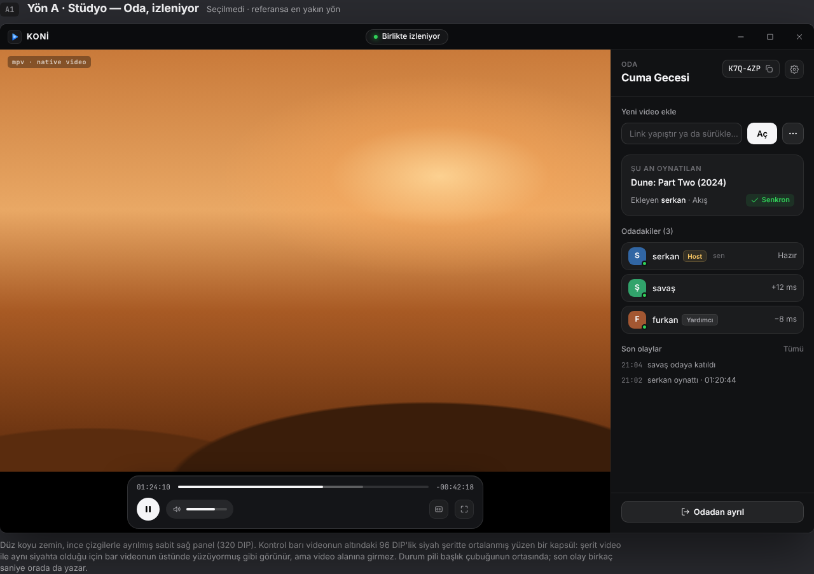
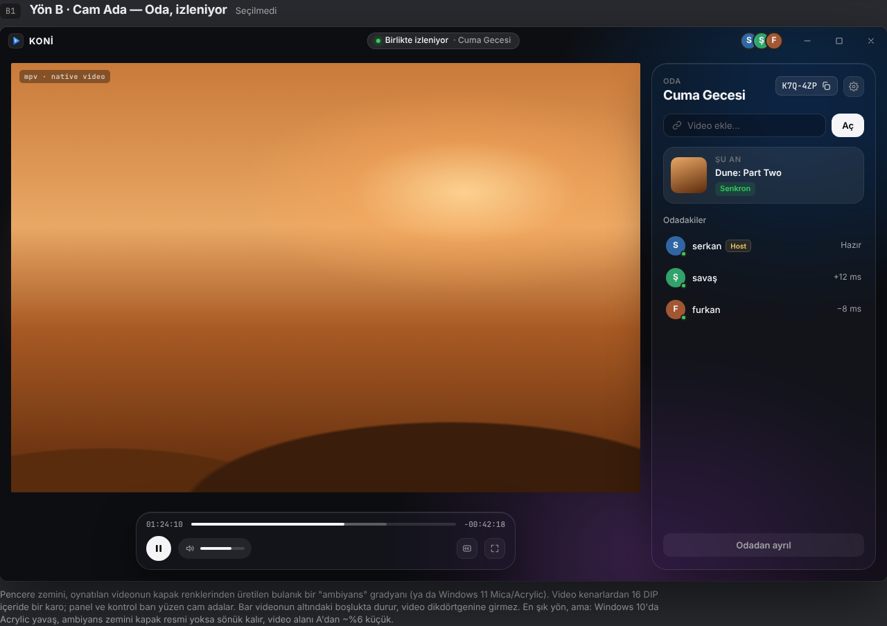
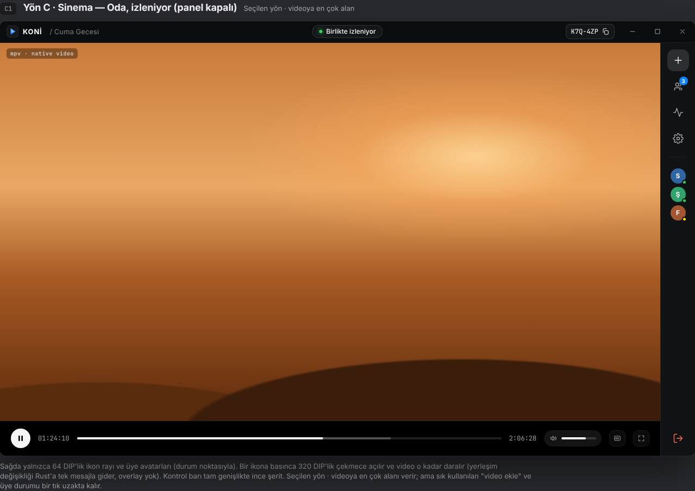
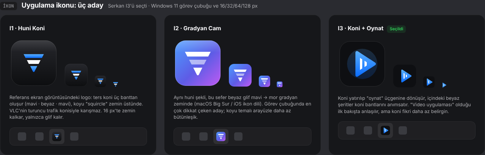

# KONİ — Arayüz ve Kullanıcı Deneyimi Planı

> Durum: **yön ve ikon seçildi (2026-10-29): Yön C · Sinema + İkon I3.** Başlık çubuğu ve ana ekran soruları için önerilen seçenekler varsayıldı (§10).
> Mockuplar: [`design/mockups/koni-ui.html`](design/mockups/koni-ui.html) (tarayıcıda aç) · ekran görüntüleri: [`design/img/ui/`](design/img/ui/)
> Kısıtlar: [client.md §3.1–3.2](design/client.md) (kokpit modeli, video üstünde overlay yok).

## 1. Neden yeniden tasarım

0.0.2'deki buzlu cam denemesi beklenen sonucu vermedi:

- Uygulama ikonu değişmedi; hâlâ VLC'yi andıran turuncu trafik konisi.
- Sağ panel "form yığını": sunucu adresi, hesap, oda kur, katıl, video aç ve etkinlik günlüğü aynı sütunda, aynı ağırlıkta.
- Referans ekran görüntüsündeki düzen yok: üstte ince başlık çubuğu ve durum pili; sağda oda adı + kod, video ekle, şu an oynatılan, odadakiler; altta ortalanmış yüzen kontrol barı.
- Giriş, oda kurma ve izleme tek ekranda karışık; kullanıcı "şimdi ne yapmalıyım" sorusuna cevap bulamıyor.

Hedef: referanstaki sade düzen + Apple'ın koyu tema dili (sistem renkleri, Inter/SF benzeri tipografi, hafif cam yüzeyler), ve **her adımın kendi ekranı**.

## 2. Değişmeyen kısıt: video üstüne çizim yok

mpv, Tauri penceresinin içinde ayrı bir native pencerede (child HWND) çizer. Web katmanı o dikdörtgenin üstüne hiçbir şey koyamaz (client.md §3.1, ADR 0001). Bu planın tüm çözümleri bu kurala uyar:

| İstenen | Nasıl yapılıyor |
|---|---|
| Kontrol barı | Videonun altında 64 DIP'lik tam genişlik **siyah şerit** (Yön C). Şerit video ile aynı siyah olduğu için videonun devamı gibi görünür. (A/B'de aynı fikir: 96 DIP şeritte ortalanmış yüzen kapsül.) |
| Bildirimler, bekleme durumu | Başlık çubuğundaki durum pili + kontrol şeridindeki kapsül + çekmeceler. Tam ekranda mpv'nin kendi OSD'si (`show-text`). |
| Menüler, açılır listeler, paneller | Çekmece video yanına açılır ve videoyu daraltır (yerleşim değişir); menüler çekmecenin içinde ya da şeritte yukarı doğru; video dikdörtgenine taşmaz. |
| Tam pencere ekranlar (giriş, ana ekran, ayarlar) | Video yüzeyi gizlenir (`mode: "hidden"`), tüm pencere web olur. |
| Video yokken "Oynatmaya hazır" | Yüzey gizli, video alanını web çizer; medya yüklenince yüzey görünür. |
| Cam efekti | `backdrop-filter` yalnızca web'in arkasındaki web'i bulanıklaştırır, videoyu bulanıklaştıramaz. Cam bu yüzden çekmece kartları, menüler ve tam pencere ekranlardaki (giriş, ana ekran) kartlarda; oda ekranının zemini düz koyu. |

## 3. Tasarım yönleri

Oda (izleme) ekranı için üç alternatif çizildi. **Serkan C'yi seçti**; oda ekranının tüm durumları C ile çizildi (C1–C7). Giriş, ana ekran ve ayarlar yönden bağımsız tam pencere ekranlar (E1–E4).

| | A · Stüdyo | B · Cam Ada | **C · Sinema ✓ seçildi** |
|---|---|---|---|
| Görüntü |  |  |  |
| Fikir | Referansın birebir iskeleti. Düz koyu zemin, ince çizgiyle ayrılmış sabit sağ panel, siyah şeritte yüzen dock. | Pencere zemini videonun renklerinden bulanık ambiyans ya da Windows 11 Mica. Video kenarlardan içeride bir karo; panel ve dock yüzen cam adalar. | Sağda 64 DIP ikon rayı + üye avatarları. İkona basınca 320 DIP çekmece açılır, video daralır. Tam genişlik ince kontrol şeridi. |
| Video alanı (1280×800) | 960×664 | 908×620 | 1216×696 (çekmece kapalı) |
| Artı | Her şey tek bakışta; Win10/11'de aynı; en az risk. | En "Apple" görünen. | Videoya en çok alan. |
| Eksi | En az "gösterişli". | Win10'da Acrylic yavaş; kapak resmi yoksa zemin sönük; Mica + child HWND [doğrulanmalı]. | Video ekleme ve üye durumu bir tık uzakta. |

C'nin bilinen eksisi (video ekleme ve üye durumu bir tık uzakta) şöyle telafi ediliyor: video yokken "Video ekle" çekmecesi açık gelir; bekleme ve indirme gibi kişiyle ilgili durumlarda Kişiler çekmecesi kendiliğinden açılır; raydaki avatarlarda durum noktası, Kişiler ikonunda sayı rozeti var; davet kodu her zaman başlık çubuğunda.

## 4. Uygulama ikonu



| | Açıklama |
|---|---|
| I1 · Huni Koni | Referanstaki logo: üç banttan ters koni (mavi · beyaz · mavi), koyu squircle zemin. VLC ile karışmaz, koyu arayüzle bütünleşik. 16 px'te zemin kalkar. |
| I2 · Gradyan Cam | Aynı huni, beyaz glif mavi→mor gradyan zeminde. Görev çubuğunda en çok dikkat çeken. |
| **I3 · Koni + Oynat ✓ seçildi** | Yatırılmış koni = oynat üçgeni, içinde koni şeritleri. "Video uygulaması" olduğu hemen anlaşılır. Koyu squircle zemin, mavi gradyan glif; 16 px'te zemin kalkar. |

Teslim: tek SVG kaynak (`client/src-tauri/icons/koni.svg`) → `tauri icon` ile `icon.ico` (16/24/32/48/64/256), `32x32.png`, `128x128.png`, `128x128@2x.png`, `icon.png`. Başlık çubuğundaki küçük logo ve kurulum (NSIS) ikonu da aynı kaynaktan.

## 5. Kullanıcı akışları

```
İlk açılış ──► Giriş / Kayıt (E1) ──► Ana ekran (E2) ──┬─► Oda kur ──► Oda: boş, Video ekle açık (C3) ──► video aç ──► Oda: izleniyor (C1)
   ▲ oturum varsa doğrudan ───────────────────┘        ├─► Koda katıl ──► Oda (o anki durum)
                                                         ├─► Son oda ──► Koda katıl
                                                         ├─► Tek başına izle ──► Oynatıcı (ray yok)
                                                         └─► Avatar ▸ Ayarlar (E3) / Çıkış
Oda içinde: Bekleme (C2) · Etkinlik (C4) · Herkes indirsin (C5) · Kopma / ayrı izleme (C6) · Oda ayarları (C7) · Tam ekran (E4)
Odadan ayrıl (raydaki kırmızı ikon) ──► Ana ekran
```

### 5.1 İlk açılış ve giriş (E1)
1. Kayıtlı oturum varsa (Windows Kimlik Bilgisi Yöneticisi) bu ekran atlanır → Ana ekran.
2. Tek cam kart, iki sekme: **Giriş yap** (kullanıcı adı, şifre) · **Davet kodum var** (kullanıcı adı, şifre, hesap davet kodu → Kayıt ol).
3. Sunucu varsayılan ana sunucu; altta tek satır, "Sunucuyu değiştir" ile açılır.
4. Hatalar alanın altında kırmızı tek satır: "Şifre yanlış", "Bu davet kodu kullanılmış", "Sunucuya ulaşılamadı · Tekrar dene".
5. Hesapsız (açık) sunucuda yalnızca kullanıcı adı sorulur.

### 5.2 Ana ekran (E2)
- "Selam serkan" + iki büyük kart: **Oda kur** (oda adı, Kur) · **Odaya katıl** (davet kodu, Katıl).
- Panoda geçerli bir davet kodu varsa "Odaya katıl" kendiliğinden dolar.
- **Son odalar**: bu bilgisayarda tutulan son 5 oda; tıklayınca katıl. Sunucuda yeni bir şey gerekmez.
- **Tek başına izle**: oda olmadan oynatıcı (bugünkü solo mod).
- Sağ üst avatar menüsü: Ayarlar, Çıkış yap.

### 5.3 Oda iskeleti (C1)
- **Başlık çubuğu (40 DIP)**: logo + "KONİ / Cuma Gecesi" · ortada durum pili · sağda davet kodu çipi (tıkla = kopyala) · pencere butonları.
- **Video**: ray ve kontrol şeridi dışındaki tüm alan.
- **Kontrol şeridi (64 DIP, tam genişlik, siyah)**: oynat · geçen süre · seek · toplam süre · [durum kapsülü] · ses · altyazı · tam ekran. Hız seçici yok (odada senkron motoru yönetir; tek başına modda ayarlarda).
- **Ray (64 DIP, sağda)**: Video ekle `+` · Kişiler (sayı rozeti) · Etkinlik · Oda ayarları · ayırıcı · üye avatarları (durum noktası: yeşil hazır, sarı bekleniyor, kırmızı/gri koptu) · en altta kırmızı "Odadan ayrıl".
- **Çekmece (320 DIP)**: raydaki bir ikona basınca rayın soluna açılır, video o kadar daralır (overlay değil, yerleşim değişir). Aynı anda tek çekmece; aynı ikon ya da ✕ kapatır. Avatar tıklaması Kişiler çekmecesini açar.

### 5.4 Oda: boş (C3)
- Odaya girince video yoksa **Video ekle** çekmecesi açık gelir.
- Çekmece: link kutusu + beyaz "Aç" · büyük satırlar: Dosya seç (Ctrl+O), Herkes indirsin, Altyazı ekle, Sayfadan yakala (Sanal Yakalayıcı) · tek kişiyken "Arkadaşlarını çağır" kartı.
- Video alanı: "Oynatmaya hazır" + ipuçları (Ctrl+V, dosya sürükle). Pencerenin herhangi bir yerinde Ctrl+V linki kutuya koyar.
- Video açılınca çekmece kapanır, video tüm alana yayılır.

### 5.5 Oda: izleniyor (C1) ve Etkinlik (C4)
- Pil: "Birlikte izleniyor". Bir olay olunca 4 sn olayı gösterir ("savaş durdurdu · 01:24:10").
- **Etkinlik** çekmecesi: üstte **Şu an oynatılan** kartı (kapak, başlık, ekleyen, kaynak, durum etiketi: Senkron · Çözülüyor · Bekleniyor · Dosyanı aç · Hata), altında olay akışı.

### 5.6 Bekleme / tampon (C2)
- Pil sarı: "furkan bekleniyor · %65"; raydaki avatarın noktası sarı. Pile tıklamak Kişiler çekmecesini açar.
- Kişiler çekmecesinde ilgili satır genişler: tampon barı, kalan süre. Kronik takılmada (4 dk'da 3) host ve yardımcı hostlar orada **"furkan olmadan devam et"** görür; bu durumda çekmece host için kendiliğinden açılır.
- Host bir üyenin üstüne gelince "⋯": Yardımcı yap / kaldır.

### 5.7 Herkes indirsin (C5)
- Kişiler çekmecesi kendiliğinden açılır: herkesin barı, hızı, kalan süresi; biten yeşil "İndirdi", hata kırmızı "İndiremedi" (+ kendisine "Tekrar dene"). Raydaki rozet "2/3".
- Video yüzeyi gizli, ortada ilerleme halkası ve "Hazır olanlarla başla". Herkes hazır → 3-2-1 → video görünür, çekmece kapanır.

### 5.8 Kopma ve ayrı izleme (C6)
- Çekmece kapalıyken de görünsün diye uyarılar başlıkta ve kontrol şeridinde:
  - Kırmızı pil "Bağlantı koptu · yeniden deneniyor (2)" (video yerelde sürer, 70 sn denenir). Raydaki avatarlar soluk.
  - Kontrol şeridinde sarı kapsül "4:12 geridesin · **Odayla senkronla**". Seek barında sarı çizgi = odanın konumu.

### 5.8b Oda ayarları (C7)
- Dişli çekmecesi: "Yalnızca hostlar kontrol eder" anahtarı (host olmayana salt-okunur) · Yardımcı hostlar · Altyazı gecikmesi (−/+, G/H) · Senkron ayrıntıları.

### 5.9 Uygulama ayarları (E3)
- macOS Sistem Ayarları düzeni: solda bölümler, sağda gruplu listeler. Video gizli.
- Hesap (ad, sunucu, çıkış, avatar rengi) · Oynatma (donanım hızlandırma, varsayılan kalite) · Altyazı (yazı boyutu, varsayılan dil) · Sunucu (adres, bağlantı testi) · Hakkında (sürüm, güncelleme, yt-dlp, lisanslar/LGPL).

### 5.10 Tam ekran (E4)
- Yalnızca mpv. Olaylar mpv OSD ile 3 sn. Esc ya da çift tık → kokpit (çekmece kapalı).

### 5.11 Kısayollar
`Boşluk` oynat/durdur · `F` tam ekran · `Esc` tam ekrandan çık · `M` sesi kapat · `↑/↓` ses · `G/H` altyazı ±50 ms · `Ctrl+V` link yapıştır · `Ctrl+O` dosya aç · `U` Kişiler çekmecesi · `Ctrl+Shift+C` davet kodunu kopyala.

## 6. Durumlar

| Durum | Nerede, nasıl |
|---|---|
| Boş | Video alanında ikon + tek cümle + ipucu (C3). Odada tekken davet kartı. |
| Yükleniyor | "Aç" butonu "Açılıyor…" + spinner; "Şu an oynatılan" etiketi "Çözülüyor…". Sayfa geçişlerinde iskelet yok, 200 ms altı. |
| Hata (alan) | Alanın altında kırmızı tek satır, alan kenarı kırmızı. |
| Hata (oda) | Pil rengi (kırmızı/sarı) + kontrol şeridinde eylem kapsülü; çekmece açıksa tepesinde şerit kart. |
| Reddedildi (yetki) | Pilde 3 sn: "Bu odada yalnızca hostlar kontrol eder". |
| Sunucuya ulaşılamıyor | Giriş/ana ekranda kartın altında kırmızı satır + "Tekrar dene". |

## 7. Tasarım sistemi

**Renk** (koyu tema, Apple sistem renkleri)

| Belirteç | Değer | Kullanım |
|---|---|---|
| `--bg` | `#0b0c0e` | pencere zemini |
| `--panel` | `#111214` | ray ve çekmece |
| `--glass` / `-2` / `-3` | beyaz %4.5 / %8 / %12 | kart, buton, seçili |
| `--line` / `-2` | beyaz %7 / %12 | ayırıcı, kenar |
| `--text` / `-2` / `-3` | `#f5f5f7` / `#a1a1a6` / `#6e6e73` | metin |
| `--accent` | `#0a84ff` | odak, bilgi, ilerleme |
| `--ok` / `--warn` / `--bad` | `#30d158` / `#ffd60a` / `#ff453a` | durum |
| host | `#ffcc66` | Host rozeti |

Birincil eylem beyaz buton + siyah yazı (referanstaki "Aç"); giriş ekranında mavi.

**Tipografi**: Inter (OFL, uygulamaya gömülü; SF Pro Windows'ta lisanslı değil). 28 başlık · 17 oda adı · 13 gövde · 12 ikincil · 11 büyük harf üst etiket. Zaman, davet kodu ve teknik değerler JetBrains Mono (OFL). Başlıklarda −0.015/−0.025em harf aralığı.

**Ölçü**: 4 pt ızgara (4, 8, 12, 16, 24, 32). Köşe yarıçapı 6 · 10 · 14 · 20 · tam. Kontrol yüksekliği 34 (büyük 42, küçük 26).

**Cam**: yüzey beyaz %4–12 + 1 px beyaz %7–12 kenar + üstte 1 px iç parlama; blur 24 px (menü, çekmece kartları) / 40 px (giriş ve ana ekran kartları), `saturate(160–180%)`.

**İkonlar**: Lucide (ISC lisans), 1.75 çizgi, 14/16/20 px. SF Symbols Windows'ta kullanılamaz.

**Hareket**: 160–220 ms ease-out. Çekmece açılıp kapanırken video yeniden boyutlanır; web tarafı çekmeceyi kaydırır, Rust video dikdörtgenini tek adımda değiştirir (animasyonsuz, titreme olmasın diye). Pil metni çapraz geçiş.

**Yerleşim (kokpit)**: başlık çubuğu 40 · kontrol şeridi 64 · ray 64 · çekmece 320 DIP. 1280×800'de video 1216×696 (çekmece açık 896×696). Pencere asgari 900×560: video 836×456 (çekmece açık 516×456).

## 8. Teknik etkiler

- **Özel başlık çubuğu**: `tauri.conf.json` → `decorations: false`, `data-tauri-drag-region`, kendi küçült/büyüt/kapat butonları. Windows'ta Snap Layouts için büyüt butonunda `WM_NCHITTEST` → `HTMAXBUTTON` [doğrulanmalı]; olmazsa native başlık çubuğu kalır, pil panelin tepesine iner.
- **`LayoutConfig`'e `topBarDip`** (`koni-surface` + `player.ts`): video dikdörtgeni üstten 40 DIP aşağı başlar. `bottomBarDip: 64`; `rightColDip` çekmece kapalıyken 64, açıkken 384 (her açma/kapamada tek `setLayout`).
- **Ekran yönlendirme**: `App.svelte` (727 satır) bileşenlere bölünür: `TitleBar`, `LoginView`, `HomeView`, `SettingsView`, `RoomView` → `Rail`, `Drawer` (`AddVideo`, `People`, `Activity`, `RoomSettings`), `MemberRow`, `NowPlaying`, `ControlBar`, `StatusPill`. Basit `view` durumu (`login | home | room | solo | settings`), router kütüphanesi yok.
- **Yüzey görünürlüğü**: `login/home/settings` ve medya yokken `mode: "hidden"`, medya yüklenince `cockpit`.
- **Son odalar**: `localStorage` (kod, ad, tarih, kişi sayısı). Sunucu değişikliği yok.
- **Fontlar**: Inter ve JetBrains Mono `client/src/assets/fonts` altına (woff2, ~300 KB).
- Protokolde değişiklik yok.

## 9. Uygulama sırası (onaydan sonra)

Her adım ayrı, küçük PR:

1. **U1 · Temel**: tasarım belirteçleri (CSS değişkenleri), fontlar, Lucide ikonları, yeni uygulama ikonu, özel başlık çubuğu + `topBarDip`.
2. **U2 · Giriş ve ana ekran**: `LoginView`, `HomeView`, son odalar, görünüm durumu, yüzey gizleme.
3. **U3 · Oda ekranı**: ray, çekmeceler (Video ekle, Kişiler, Etkinlik, Oda ayarları), kontrol şeridi, durum pili, davet çipi.
4. **U4 · Oda durumları**: bekleme, herkes indirsin, kopma/ayrı izleme; çekmecelerin kendiliğinden açılması.
5. **U5 · Uygulama ayarları** ve kısayollar; 0.0.3 sürümü.

## 10. Kararlar

| Soru | Karar |
|---|---|
| Yön | **C · Sinema** (Serkan, 2026-10-29) |
| İkon | **I3 · Koni + Oynat** (Serkan, 2026-10-29) |
| Özel başlık çubuğu | Evet (önerilen, varsayıldı; Snap Layouts çalışmazsa yeniden sorulur) |
| Son odalar ve "Tek başına izle" | Ana ekranda kalır (önerilen, varsayıldı) |
